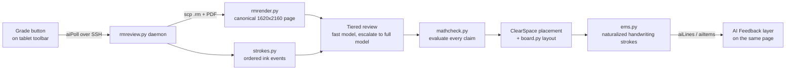

# reMarkable Paper Grader

Handwritten work grader for e-ink tablets: press a Grade button on a reMarkable Paper Pro, and an AI model reviews the handwritten work on that page and writes its feedback back onto the page as real pen strokes, in a separate layer the user can delete.

## Why it exists

Working practice problems by hand on paper-like e-ink is good for learning, but feedback usually means retyping work into a computer or photographing it. This project closes that loop on the device itself. You write, tap Grade, and a few seconds later the margin carries a verdict, a struck-through mistake, the worked continuation from the point where things went wrong, and a short question to answer with a tick. Feedback lands in its own "AI Feedback" layer and never overwrites or erases the student's ink. The first use was exam preparation (math, reading and data practice pages).

## How it works (diagram)



## Features

- **Button-triggered.** A Grade button added to the tablet toolbar grades the current page, a set number of pages, or the whole notebook.
- **Real ink, separate layer.** Feedback is written as native strokes into an "AI Feedback" layer. The bridge has no erase or delete commands.
- **Reads stroke order.** The tablet's stroke file stores strokes in creation order, so the reviewer sees what was written first, not only the final page.
- **Tiered review.** A cheaper model handles clean, correct pages; anything doubtful escalates to the full model. Batches review pages in parallel.
- **Checked claims.** Every equation the reviewer wants to write is evaluated before it is inked; false ones are dropped. Statements about motives or feelings are filtered out.
- **Never writes over the student.** A free-space finder places each note in empty space, moves it, or moves it to a continuation page; skipping a mark beats overprinting.
- **Natural-looking handwriting.** A single-stroke font with pen dynamics (dwell, taper, slant, drift) carried in per-point width, the one width channel the firmware honors.
- **Zoom-proof capture.** Pages are rendered from the stroke file; screenshots of unflushed pages are re-projected into page space.
- **No double grading.** A fingerprint of the student's strokes stops an unchanged page from being inked twice.

## How it works

The daemon (`rmreview.py`) runs on a computer and talks to the tablet over SSH through a small QML bridge (`tablet/gradebridge.qmd`) loaded by the open-source XOVI extension framework. Key decisions:

- **Grading happens in `rmreview.review()` and `review_tiered()`.** They build a prompt from the page image plus the ordered stroke list and call a model through the Claude Code command-line tool, which returns strict JSON (verdict, trace, first error, worked route, footer, annotations). The reviewer reads the image with a file-read tool only. Changing the model backend means replacing those two functions.
- **Page context is optional.** The original deployment looked up each page's question and verified answer from a private question bank through a module named `books` (`context(pdf, page_index) -> dict`). That module and its data are not included. Without it the reviewer grades from the handwriting alone and is told it cannot see the question. You can add your own adapter with the same function.
- **One coordinate source of truth.** Ink lives in page space at 3.128 px per PDF point. `rmrender.page_transform()` supplies the scale to the renderer, the stroke extractor and the write-back path. This fixed a bug where Letter-size worksheets rendered ink 18% too large. See [docs/ink-rendering-and-scale.md](docs/ink-rendering-and-scale.md).
- **Chronology over guesswork.** The prompt allows the model to describe only what the ink shows, with at most one uncertain reading, and forbids guessing why a student made a mistake.
- **Show the work on wrong pages.** A wrong or blank page gets the full worked continuation; a correct, efficient page gets almost nothing.
- **A font, not a neural model, for handwriting.** Neural handwriting generators failed on math symbols and digits; a single-stroke font plus structured pen dynamics stays legible. See [docs/handwriting.md](docs/handwriting.md).

The full path of one button press is in [docs/capture-and-review-loop.md](docs/capture-and-review-loop.md).

## Quick start

**Requirements**

- A reMarkable Paper Pro in developer mode with SSH key access, firmware 3.27.3 (the only version tested), with the XOVI stack and the bridge installed. See [tablet/README.md](tablet/README.md).
- Python 3.14 (tested) and the packages in `requirements.txt`.
- The Claude Code CLI (`claude`) installed and signed in. The daemon strips `ANTHROPIC_API_KEY` from the environment it passes to the CLI.

**Install**

```bash
python3 -m venv .venv
.venv/bin/pip install -r requirements.txt
```

**Configure** (environment variables; all optional)

| Variable | Default | Meaning |
|---|---|---|
| `RM_HOST` | `root@10.11.99.1` | tablet over USB |
| `RM_WIFI_HOST` | unset | tablet over Wi-Fi, tried first (for example `root@TABLET_IP`) |
| `GRADER_CLAUDE_BIN` | `claude` | model CLI |
| `GRADER_MODEL` | CLI default | model for the full review |
| `GRADER_TRIAGE_MODEL` | `sonnet` | model for the fast first pass |
| `GRADER_STUDENT_NOTE` | generic | one paragraph about the student for the prompt |

**Run**

```bash
.venv/bin/python rmreview.py doctor   # self-check; ends by pinging the tablet bridge
nohup .venv/bin/python -u rmreview.py >> work/daemon.log 2>&1 &
```

Then tap the Grade button on the tablet. Importing `rmreview.py` probes the tablet over SSH, so run it only with the tablet connected. Runtime state goes to `work/`, pulled PDFs to `cache/`.

## Project structure

```
rmreview.py          daemon: poll, capture, review, place, write back; `doctor` self-check
rmrender.py          renders a page's .rm strokes over its PDF; owns page_transform()
strokes.py           ordered ink events from a .rm file
board.py             the two-column "you did / do this" feedback board
mathcheck.py         evaluates equations, filters banned wording, guards answer leaks
readback.py          reads the student's ticks in footer boxes; student-ink fingerprint
ems.py               EMS Casual Hand renderer and naturalize() pen dynamics
hershey.py           Hershey font renderer (fallback, not used by the daemon)
calibration.json     measured pixel <-> scene transform
EMSCasualHand.svg    single-stroke font (SIL OFL 1.1, see EMSCasualHand-FONT-NOTICE.txt)
futural.jhf          Hershey Futura font (public domain)
tablet/              QML bridge, spike checklist, deploy script
tools/               offline scripts to build the optional human glyph bank
docs/                ink scale, handwriting, and review-loop write-ups
```

## Status and roadmap

**Paused.** The full loop (button press, capture, review, ink in the AI Feedback layer) was built and used on the device in August 2026, including 24-page batches. The daemon is not currently running.

Known limits:

- Tested on one device, firmware 3.27.3 only. The extension stack is tied to that firmware.
- The ink-scale fix for Letter-size PDFs was verified numerically but not yet on paper.
- Zoom handling was verified on synthetic cases; a real pinch-zoom test has not been run.
- The model backend is the Claude Code CLI. An experimental local-model backend existed in the original project but was never run and is not included.
- Exam-specific modules (question lookup, practice-test score sheets, day-log form filling) are not included; their menu actions print a notice and do nothing. Running-summary generation (`report` module) is also not included.
- Without the optional `human_glyphs.json`, the symbols `√ ≤ ≥ → ≠` are written in ASCII.
- There is no automated test suite in this repository; the original regression corpus contained private handwriting and was left out.

## How this was built

Ryan Wisth built this by directing AI coding agents (Claude Code). He set the goals, the safety rules (never touch the student's ink, no erase commands, button-triggered only), the acceptance checks and the design specs, tested each stage on his own tablet, and judged the results. The agents wrote most of the code and ran the research passes summarized in `docs/`.

## License

MIT, see [LICENSE](LICENSE). EMS Casual Hand is under the SIL Open Font License 1.1 ([EMSCasualHand-FONT-NOTICE.txt](EMSCasualHand-FONT-NOTICE.txt)). Hershey fonts are public domain.

This is an unofficial project, not affiliated with or endorsed by reMarkable AS. "reMarkable" and "Paper Pro" are trademarks of reMarkable AS. Running it requires putting the tablet in developer mode and loading third-party extensions; do so at your own risk. Back up your notebooks first.
